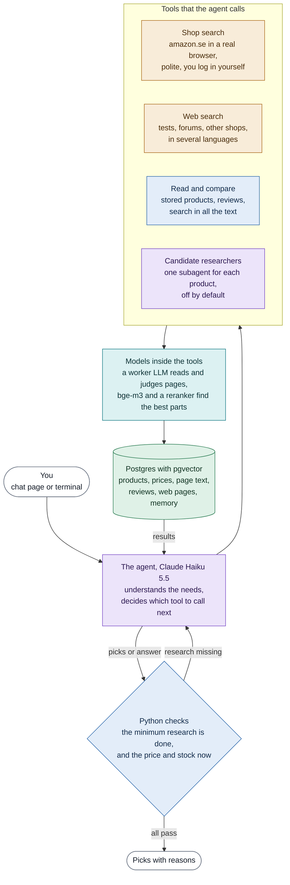

# Luna, a product research agent

Luna is a shopping research agent for shoppers in Sweden. You tell it what you need. It searches amazon.se, other shops and the web, reads the buyer reviews and the tests, checks the price and stock again, and shows a few picks with the reasons.

It works for any kind of product. The tests use fridges, headphones, incense and running shoes. It answers in English, Swedish or Chinese.

**Live demo** coming soon (`https://<demo-url>`)

The project was called product-scout until 2026-10-27. Some older plans and names in the code still use that name.

## What it does

1. **Asks what is missing.** When you give no budget or must-haves, Luna asks once before it searches.
2. **Records your needs.** Only the numbers that you wrote become conditions. A budget is a hard limit, and price never ranks the picks.
3. **Searches.** amazon.se in a real Chrome window at a polite rate, and the web through a self-hosted SearXNG, also in other languages, to find tests, forum threads and other shops.
4. **Researches the candidates.** It reads the buyer reviews and the web pages about each candidate that it may recommend.
5. **Gives the picks.** Python checks that the shop search, the reviews and a web search for tests are done, and opens each pick again for the price and stock now. Missing research goes back to the agent.

You always log in and solve captchas yourself. The program never types passwords and never bypasses a captcha.

## How it works

A tool-calling agent (Claude Haiku 5.5) leads each turn in LangGraph. It has 23 tools. Python runs the tools, keeps the limits of the turn, and checks the floors before any pick is shown. Each value that a model extracts from a page keeps its raw text, and Python finds that text in the source before it stores the value.

The full design with ten flowcharts is in [docs/architecture.md](docs/architecture.md).



## How it is measured

All numbers come from real runs. Each run is small, so read them as early signals, not as benchmarks.

| Test | What it measures | Result |
| --- | --- | --- |
| eval-hidden | A simulated shopper wants one real amazon.se product and knows only its facts. Does the agent find it, and at what cost? Based on the idea of WebShop (Yao et al., 2022) | Claude Haiku 5.5 found 10 of 12 fridge targets (6 at place 1), median 0.038 USD and 617 s a run (2026-10-13). GPT-6 Luna found 7 of 12 with the same prompt |
| Researchers on and off | The same 21 targets in 4 categories with and without the candidate subagents, one run each | 10 found with them, 9 without. 10 targets changed between the runs, so this is noise. The cost was 1.07 against 0.55 USD, so they are off by default (2026-10-22) |
| check-grader | Can the grader model find planted faults in replies? | GPT-6 Luna Pro found 31 of 32 planted faults but failed 7 correct replies (2026-10-15). So I also read the replies myself |
| eval-search | The shop search alone on saved pages, without a model and without cost | Used to choose the default order of amazon.se |
| eval-retrieval | Recall and rank of five search methods over the stored text | Questions in several languages were best (2026-10-13) |
| Unit and integration tests | `python -m pytest` | 561 pass (2026-10-27) |

## Built with

| Part | Choice |
| --- | --- |
| Agent loop | LangGraph with Postgres checkpoints, optional parallel subagents |
| Models | Claude Haiku 5.5 for chat and the worker, through OpenRouter. Free Gemini as the fallback. Any OpenAI-compatible provider can take a role (`config/models.yaml`) |
| Local models | bge-m3 (dense and sparse vectors), bge-reranker-v2-m3, on the GPU when there is one |
| Retrieval | Hybrid search with dense vectors, sparse weights and our own BM25, merged by RRF |
| Data | Postgres 17 with pgvector 0.8 |
| Sources | amazon.se through Playwright and Chrome, the web through SearXNG and Tavily, the Prisjakt, Feefo and Reddit APIs |
| Interface | A FastAPI chat page and a terminal chat |
| Tracing | Langfuse (optional) |
| Deployment | Docker Compose with the app, Postgres, SearXNG and an optional Cloudflare tunnel. Chrome stays on the host |

## Run it

You need Docker, Google Chrome, conda and an API key for at least one LLM provider.

```bash
conda create -n product-scout python=3.10
conda activate product-scout
uv pip install -e ".[dev]"            # add ".[retrieval]" for bge-m3 on the host
cp .env.example .env                  # then fill in the keys
docker compose up -d                  # Postgres + pgvector and SearXNG
python -m pytest                      # tests with the mark db need the container
```

Chat in the terminal or on the web page.

```bash
scout chat
scout web                             # http://127.0.0.1:9000
```

Or run the app in Docker. Start Chrome first with `scripts/start-browser.ps1`, so that the app can use its window for amazon.se. Log in there yourself.

```bash
docker compose --profile app up -d --build
```

The evaluations are `scout eval-hidden`, `scout grade`, `scout check-grader`, `scout eval-search` and `scout eval-retrieval`. Runs that call a paid model cost money.

## Repository layout

```
src/scout/agent/     the agent loop, the tools, the floors, the researchers
src/scout/sources/   amazon.se and other shops, the browser
src/scout/extract/   field extraction with the raw-text check
src/scout/text/      chunks, embeddings, hybrid retrieval, reranking
src/scout/picks/     the ranking, the live recheck, the pick texts
src/scout/eval/      eval-hidden, the grader, eval-search, eval-retrieval
src/scout/web/       the FastAPI chat page
profiles/            category profiles (YAML)
config/              the models of each role, the review sources
eval/                the hidden targets and the grader test set
docs/                the architecture, the design and the plans of each phase
```

## Data and fair use

- Luna fetches at a low rate (about 5 s between amazon.se pages, 3 s per site on the web) and logs every request.
- Fetched pages, snapshots, evaluation results and the browser profile stay on the computer. They are not in this repository.
- Reviews are stored without the names of their authors.
