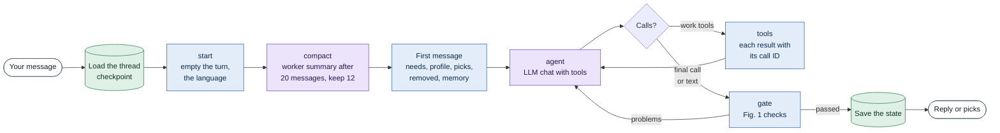
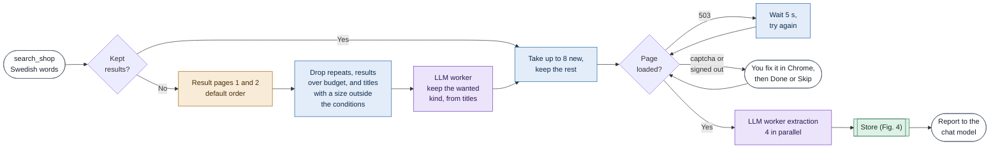
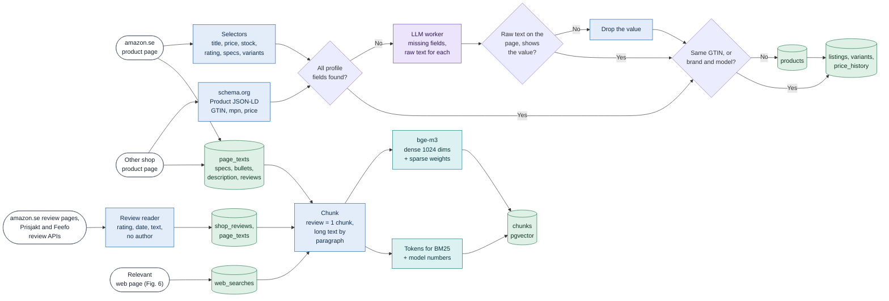
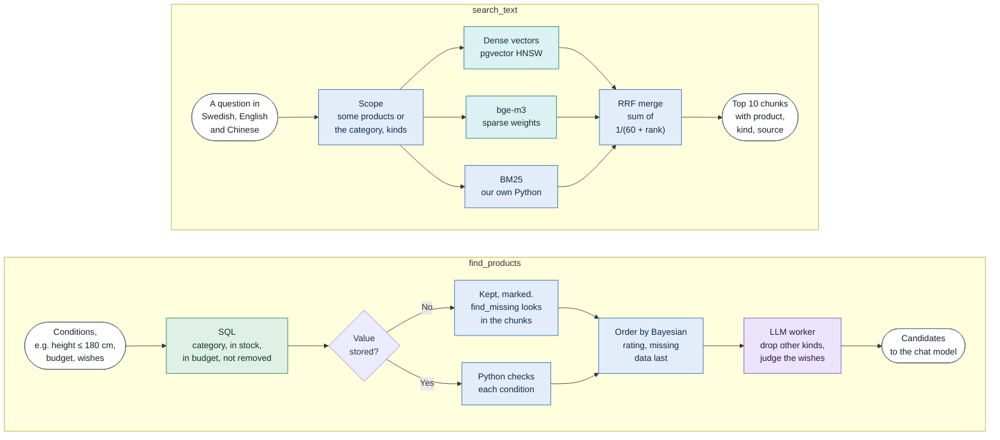
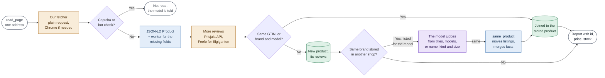
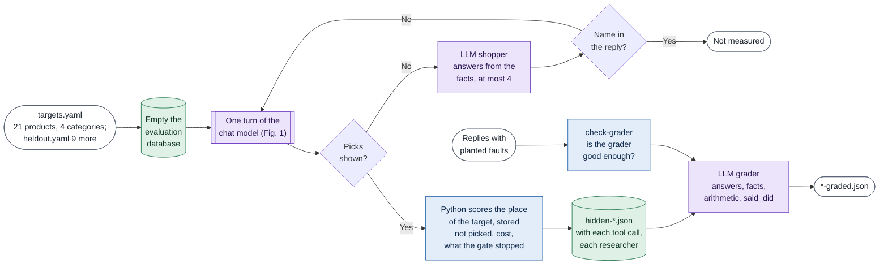
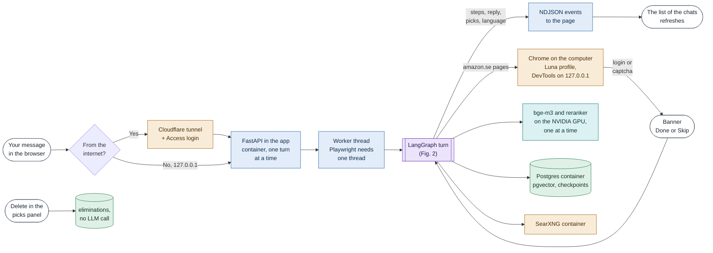

# Luna architecture

This page shows the code on 2026-10-27. Each chart runs from left to right. The chat model (Claude Haiku 5.5) leads each turn. It calls tools, Python runs them, and Python checks that the research is done before you see the picks. Python does not check the facts of the answers. A second model, the grader, checks them in the evaluation (Fig. 9).

Colors show who does the work.

| Color | Who |
| --- | --- |
| Orange | A website (amazon.se, other shops, the web) |
| Blue | Python code |
| Purple | An LLM call |
| Teal | A local model (bge-m3, bge-reranker-v2-m3) |
| Green | Postgres |

## The models

| Role | Model | What it does |
| --- | --- | --- |
| chat | `anthropic/claude-haiku-5.5` | Leads the turn and calls the tools. Fallback `gemini-3.8-flash` |
| worker | `anthropic/claude-haiku-5.5` | Works inside the tools. It screens titles, extracts fields, summarizes reviews and judges web pages. Fallback `gemini-3.5-flash-lite`. Gemma 4 26B did this job until 2026-10-26 |
| researcher | `anthropic/claude-haiku-5.5` | One for each candidate, at the same time (Fig. 8). Off by default since 2026-10-22 |
| grader | `openai/gpt-6-luna-pro` | Checks the answers in the evaluation. It is from another maker than the chat model |
| shopper | `deepseek/deepseek-v4-flash` | Plays the shopper in eval-hidden |

All roles are set in `config/models.yaml`. The LLM layer speaks the OpenAI API, so a role can move to another provider.

## Fig. 1. One turn (the chat model works, Python checks)

Each message from you starts one turn. The chat model can ask you a question, look at the stored products, search amazon.se and the web, read pages and reviews, and then give the picks or a reply. Python runs each tool, keeps the fetching polite and checks the floors before the picks.

```mermaid
flowchart LR
  IN(["Your message"]):::io --> CM["LLM chat (Haiku 5.5)<br/>the state of the turn<br/>and its own calls"]:::llm
  CM --> WHAT{"What does<br/>it call?"}

  subgraph T["Work tools (the results go back to the chat model)"]
    direction TB
    UN["update_needs, update_profile<br/>your numbers; a draft<br/>profile for a new category"]:::code
    FP[["find_products, search_text,<br/>similar_products (Fig. 5)"]]:::code
    SS[["search_shop<br/>amazon.se (Fig. 3)"]]:::web
    RC[["research_candidates<br/>off by default (Fig. 8)"]]:::llm
    SW[["search_web, research_products<br/>tests, forums, shops,<br/>in more languages (Fig. 6)"]]:::web
    RP[["read_page, same_product<br/>other shops (Fig. 7)"]]:::web
    LK["read_product, find_missing,<br/>read_reviews, summarize_reviews"]:::code
    RM[("remove, restore,<br/>remember, forget")]:::db
  end

  WHAT -- "work tools" --> T
  T --> LIM{"Limits of the turn<br/>25 calls, 30 product<br/>pages, 30 review pages,<br/>120 web pages,<br/>10 web searches"}
  LIM -- "left" --> CM
  LIM -- "used up,<br/>answer now" --> CM

  WHAT -- "show_picks<br/>or reply" --> GATE{"The floors<br/>shop searched,<br/>reviews read,<br/>web search for tests"}
  GATE -- "reply" --> OUT
  GATE -- "show_picks" --> LIVE["Open each pick again<br/>price and stock now"]:::web
  LIVE --> OK{"All pass?"}
  OK -- "No, the problems go<br/>back, up to 3 rounds" --> CM
  OK -- "Yes" --> OUT(["Picks or reply,<br/>picks also in the panel"]):::io
  OK -- "Still not after 3" --> SAFE(["A safe message,<br/>nothing changed"]):::io

  classDef llm fill:#ece4fa,stroke:#7343c4,color:#2a1650
  classDef code fill:#e3edf9,stroke:#2462a8,color:#0f2a4a
  classDef db fill:#dff1e7,stroke:#23774c,color:#0f3322
  classDef web fill:#f8ecd9,stroke:#a86512,color:#4a2c08
  classDef io fill:#ffffff,stroke:#5a6475,color:#18202c
```

- Before the first search, the chat model asks once when you did not say the budget or the must-haves.
- A budget is a hard limit. Price does not rank the picks unless you ask for it. Luna can show fewer than 5 picks when fewer fit well, and says why.
- A price in another currency is converted to SEK with a rate that the reply states.
- Price, rating, review count and stock come from the stored record, never from the page text.
- The web searches of one round run in threads beside the other tool calls. The browser works in the main thread only.
- Python detects the language of each message (English, Swedish or Chinese) and writes its own fixed texts in it. The chat model chooses the language of its reply.
- The memory keeps what you say that stays true in a later chat, and the reasons when you remove a pick. You can see and delete it on the web page.
- A pick from another shop counts its own `read_page` as its shop search. When it is the same product as a stored one that had a web search for tests, `same_product` joins them and the floor passes.

## Fig. 2. One turn in LangGraph

`scout chat` and the web page run the same graph. Inside a turn, the chat model sees a normal chat history. It has one fixed first message, then its tool calls and their results. Postgres saves the state after each turn.

- The first message does not change inside the turn, so the provider can cache it.
- Each model call has a deadline. It is 180 s for chat, 60 s for the worker and 120 s for the grader. The judgement of one web page stops after 15 s. A reply without content is tried again like a busy server.
- Not enough credit (402) ends the turn with a clear message. It does not move to the fallback model.

## Fig. 3. search_shop on amazon.se

One call reads up to 8 new product pages in the dedicated Chrome profile. It reads result pages 1 and 2 in the default order of amazon.se. The results that did not fit are kept for the next call.

- About 5 s between two amazon.se pages. You always log in and solve captchas yourself. The program never types passwords.
- A card over the budget that has other colours gives its place to them. The page of each colour gives its own price.
- For running shoes, Python opens the page of your size before the picks and checks its price and stock.
- Why the default order? On the saved pages of 28 targets it was never clearly worse than merged orders (16 against 15 of 20, 5 against 5 of 8 held out). It loads fewer pages and meets fewer captchas. This is a choice on little data, not a measured win.

## Fig. 4. How the data is stored

Three kinds of pages come in. They are amazon.se product and review pages, product pages of other shops, and web pages from the web search. Each splits into two paths. The structured path keeps the few fields that we filter and compare on. The text path keeps the original text in chunks for retrieval.

- The raw-text check has two parts. The raw text must be on the page, and it must show the value. A bare "56" or "E" proves nothing and is dropped.
- Some shops put their own name in the brand of the page data. A brand that the title does not name goes to the worker, which reads the brand from the page text.
- One product can have listings in several shops. The reviews of all its listings belong to it. A review with the same text is kept one time.
- Each chunk keeps its source (shop text, shop review, web), its kind, and for web pages the address, the site and the date.
- The chat model judges values that cannot be right, such as a fridge 1 cm high. Python has no range rules for this.

## Fig. 5. Search over the stored data

`find_products` (top) lists the stored candidates that meet your conditions. It must see every candidate, so it runs in SQL and Python, and it does not choose for the chat model. `search_text` (bottom) finds the best passages across the product texts, the reviews and the web pages. It merges three retrievers by RRF, for the question in up to three languages.

- The Bayesian average has a prior weight of 20 reviews, so 5.0 from 2 reviews does not beat 4.6 from 3,000. Price does not affect the order.
- The questions in several languages were the best method in `scout eval-retrieval` on 2026-10-13.
- `similar_products` finds stored products like one that you liked, with the same vectors.
- `read_product` gives the full text of up to 3 products, each cut at 5,000 characters.

## Fig. 6. search_web for tests, forums and shops

The chat model or a researcher gives short search words, the products that the search is for, what it wants to learn (`want`) and the sources. The sources are the whole web, the test sites of the category, the forums, or a few shops for their buyer reviews. With `more` it gives the same search in up to 5 other languages, for example "buy", "kaufen", "acheter", "购买", "køb". Our own SearXNG finds the pages, the worker judges each one, our fetcher reads the relevant ones, and a local reranker chooses the parts that answer `want`. The chat model reads these parts, not a summary.

```mermaid
flowchart LR
  C(["search_web<br/>words, more, ids,<br/>want, sources"]):::io --> LANG["One search for each<br/>language, at the<br/>same time (up to 6)"]:::code
  LANG --> SITES["sources tests, forums<br/>or shops add the sites<br/>of review_sources.yaml"]:::code
  SITES --> ST{"Same words<br/>in 7 days?"}
  ST -- "Yes" --> JUDGE
  ST -- "No" --> SX["SearXNG in Docker<br/>Google, Bing and<br/>others, 20 pages,<br/>one search at a time"]:::web
  SX -- "no answer or<br/>captcha" --> TV["Tavily<br/>the other back end"]:::web
  SX --> JUDGE
  TV --> JUDGE["LLM worker,<br/>10 in parallel, 15 s each<br/>test, forum, shop;<br/>relevant; which product"]:::llm
  JUDGE --> REL{"Relevant?"}
  REL -- "No" --> KEEP1[("web_searches<br/>title, address,<br/>short part")]:::db
  REL -- "Yes" --> FT["Our fetcher<br/>3 s per site; next<br/>pages of a forum thread;<br/>Reddit through its API"]:::web
  FT --> CUT["Cut into parts<br/>of about 1,000<br/>characters"]:::code
  CUT --> STORE[("chunks of the<br/>products, source web,<br/>with the date")]:::db
  CUT --> RANK["bge-reranker-v2-m3<br/>on the GPU, score<br/>each part against want"]:::local
  RANK --> TOP["15 best parts,<br/>each with the part<br/>before and after"]:::code
  TOP --> REP(["Report by page,<br/>site, kind, date,<br/>address"]):::io

  classDef llm fill:#ece4fa,stroke:#7343c4,color:#2a1650
  classDef code fill:#e3edf9,stroke:#2462a8,color:#0f2a4a
  classDef db fill:#dff1e7,stroke:#23774c,color:#0f3322
  classDef local fill:#dcf1f2,stroke:#0d7680,color:#0a3236
  classDef web fill:#f8ecd9,stroke:#a86512,color:#4a2c08
  classDef io fill:#ffffff,stroke:#5a6475,color:#18202c
```

- The lists of sites are in `config/review_sources.yaml`. They hold test sites (Testfakta, Råd & Rön, M3, and some for each category), forums (SweClockers, Flashback, Reddit) and shops (Prisjakt, Elgiganten, NetOnNet, Power). The list of shops is only for buyer reviews.
- To find the shops that sell a product, the chat model searches with sources `any` and words such as "köp" or "pris", also in the languages of the nearby countries. Shops in other EU countries count, and the reply names their currency.
- For questions about prices or where to buy, a shop page with only a name and a price counts as relevant. For tests and reviews it does not.
- SearXNG gets one search at a time. On 2026-10-26, four searches at the same time gave 7 results in place of 20. The pages of the results still load and get judged in parallel.
- SweClockers threads are read up to 2 more pages. Reddit threads are read through the official API when its key is set (the post and up to 200 comments, no user names). Flashback blocks reading, so it gives only the short part of the search result.
- A search of shops or forums only does not count as a web search for tests.
- SearXNG needs no key and no credits. An engine that shows a captcha is left out. The program never bypasses it. Tavily then answers, on its free plan.
- Why a reranker and not the vectors of bge-m3? The vectors scored menus that repeat the model name high, and buyer reviews about noise that do not name the model low.
- A test counts for a pick only when it is about the same model and variant.

## Fig. 7. Pages of other shops (read_page and same_product)

A web search can find a model on the page of another shop or on Prisjakt. `read_page` reads it, with its buyer reviews, and stores the product. When the same product is already stored from amazon.se or another shop, the listings become one product.

- A product without a model number (a perfume, a food) is the same when the name, the kind and the size are the same. For a perfume that is the same scent, concentration and ml.
- A product from another shop can be a pick. The live check opens its page again for the price and the stock.
- Joined products share their reviews and web searches.
- Each request of the review APIs goes to the fetch log, as the pages do. They keep the gap of 3 seconds of the site.
- `same_product` refuses two listings of different categories, or two listings of the same shop. If it fails, nothing changes.

## Fig. 8. The candidate researchers (off by default)

`research_candidates` sends up to 5 subagents at the same time, one for each candidate. Each researcher has its own context and tools, works on its own product only, and gives the chat model a short file. The chat model reads the files, not the pages. Since 2026-10-22 the tool is off by default, and eval-hidden turns it on with `--researchers`.

```mermaid
flowchart LR
  C(["research_candidates<br/>up to 5 ids, a wish"]):::io --> RV["Read the amazon.se<br/>reviews first<br/>(the browser has<br/>one thread)"]:::web
  RV --> SPLIT["Each gets an equal part<br/>of half of the web<br/>searches and pages left"]:::code
  SPLIT --> R1["Researcher 1<br/>Haiku 5.5, own<br/>database connection"]:::llm
  SPLIT --> R2["Researcher 2 to 5<br/>at the same time"]:::llm
  R1 --> TOOLS["read_product, search_text,<br/>find_missing, summarize,<br/>search_web, read_page;<br/>at most 8 steps"]:::code
  R2 --> TOOLS
  TOOLS --> FILE["research_file<br/>fit to the recorded<br/>needs, up to 10 points,<br/>each with a quote"]:::llm
  FILE --> Q{"Quote in its<br/>tool results?"}
  Q -- "No" --> DROP["Point left out,<br/>counted"]:::code
  Q -- "Yes" --> KEEP["Point kept"]:::code
  KEEP --> FLOOR{"Web search for<br/>tests made?"}
  DROP --> FLOOR
  FLOOR -- "No" --> PY["Python searches<br/>brand model test"]:::web
  FLOOR -- "Yes" --> OUT
  PY --> OUT(["Short files to<br/>the chat model"]):::io

  classDef llm fill:#ece4fa,stroke:#7343c4,color:#2a1650
  classDef code fill:#e3edf9,stroke:#2462a8,color:#0f2a4a
  classDef web fill:#f8ecd9,stroke:#a86512,color:#4a2c08
  classDef io fill:#ffffff,stroke:#5a6475,color:#18202c
```

- A point cannot quote the needs or the wish of the chat model, only the facts of the product and the results of its own tools.
- At most 2 web searches of all researchers run at the same time. With 5, the engines of SearXNG asked for a captcha.
- Each researcher takes a connection of a small pool (psycopg_pool) while it works, so the researchers do not wait for one another. bge-m3 and the reranker load and run one at a time.
- Four smoke runs on one target (2026-10-20 and 21) found the target at place 1 each time, at 0.028 to 0.079 USD. Each run showed a problem that is now fixed.
- eval-hidden on 21 targets (2026-10-22), one run each. With the researchers the target was picked 10 times, without them 9 times. 10 targets had a different result in the two runs, so the difference is noise. The cost was 1.07 USD with them and 0.55 USD without. The replies were of the same quality. So the researchers are off by default.

## Fig. 9. The evaluation (eval-hidden and the grader)

`scout eval-hidden` follows the idea of the WebShop benchmark (Yao et al., 2022). A simulated shopper wants one real product of amazon.se and knows only its facts, not its name. Then `scout grade` gives each answer to the grader, with everything that the chat model saw in that turn.

| eval-hidden on the first 12 fridge targets | Found in the picks | Cost of one run, median | Time of one run, median |
| --- | --- | --- | --- |
| GPT-6 Luna, 2026-10-10, first prompt | 4 of 12 (3 at place 1) | 0.015 USD | 632 s |
| GPT-6 Luna, 2026-10-13, new prompt | 7 of 12 (5 at place 1) | 0.014 USD | 670 s |
| Claude Haiku 5.5, 2026-10-13, new prompt | 10 of 12 (6 at place 1) | 0.038 USD | 617 s |

- Each row is one run of each target, so the noise is large. Haiku became the chat model because it asked for the missing budget before it searched.
- The grader is GPT-6 Luna Pro, from another maker than the chat model. In check-grader (2026-10-15) it found 31 of 32 planted faults, but it failed 7 correct replies. So I also read the replies myself against the tool results, and only answers, facts, arithmetic and said_did count.
- `scout eval-search` scores the shop search alone on the saved pages, without a model and without cost.
- The evaluation database is `product_scout_eval`. Python refuses to empty a database whose name does not end with `_eval` or `_test`.
- The result files hold page texts, so they stay out of Git. The docs keep only the sums.

## Fig. 10. The web page, and how it runs

`docker compose --profile app up -d` starts the app, Postgres and SearXNG. The page is on 127.0.0.1:9000. The list of the chats is at the left, the conversation in the middle, and the picks with links and a delete button at the right. Chrome stays on the computer, so you can log in and solve captchas yourself. With `--profile tunnel`, a Cloudflare tunnel publishes the page behind Cloudflare Access.

- The image has Python 3.10 and torch 2.6 with CUDA 12.4. bge-m3 and the reranker come from the mounted Hugging Face cache. The image has no keys, no browser profile and no stored pages.
- On an RTX 3060 in the container, the reranker scores 200 parts in 2.8 s and bge-m3 embeds 100 chunks in 1.5 s (2026-10-25). On the CPU before, one part took about 0.9 s. Without a GPU, both run on the CPU.
- The app connects to Chrome over the DevTools protocol at `host.docker.internal`. It opens its own tab and closes only that tab.
- The page has no login of its own. It is published only on 127.0.0.1, or through the tunnel with Cloudflare Access in front.
- The fixed texts follow the language of the shopper (English, Swedish or Chinese).

## Tables

Everything lives in Postgres 17 with pgvector 0.8, in Docker. `product_scout` is for daily use, `product_scout_test` for the tests and `product_scout_eval` for eval-hidden. Category profiles are YAML files in `profiles/`. A drafted or edited profile is saved in `data/profiles/`.

| Group | Table | What it holds |
| --- | --- | --- |
| Structured | `products` | The product itself (brand, model, gtin, category, attributes as jsonb with value, unit, raw, source) |
| | `listings` | Its page in one shop, with rating and review count |
| | `variants` | Size, colour, capacity, each with its own price and stock |
| | `price_history` | Every fetched price and availability |
| | `attribute_searches` | Which missing values were looked for in the text of a product, and when |
| | `site_filters` | The filters of the amazon.se search pages, for eval-search |
| Text and retrieval | `page_texts` | The newest product page text of each listing |
| | `shop_reviews` | Each review of the review pages, with the star filter that found it. No author |
| | `web_searches` | Each web search with its words, the products it was for, and the results |
| | `chunks` | Parts of the page texts, the reviews and the relevant web pages, with vector(1024) and sparse weights |
| Run records | `fetch_log` | Address, time, status and duration of every request |
| | `eliminations` | Products removed in a conversation, with the reason. They can come back |
| | `shopper_memory` | What the agent keeps about the shopper across conversations |
| | LangGraph checkpoints | Conversation state, one per thread, saved after each turn |

## Progress

Built

- Phases 1 to 3. The amazon.se reader, extraction with the raw-text check, LangGraph, the agent loop with 23 tools, the floors and the live check, retrieval, reviews, web search, other shops, memory.
- Phase 4. Profiles for headphones, incense and running shoes, drafted profiles for new categories, the shopper edits a profile.
- Phase 5. The search study, and the default order of amazon.se.
- Phase 7. The app in Docker on the GPU, Chrome over DevTools, the Cloudflare tunnel with Access.
- Candidate researchers (off by default after the A/B), review sources outside amazon.se, shops in other countries, web searches in more languages, three languages on the page, the list of the chats.

Next

- Find the cause of a rare crash in native code of the app container ("free(): invalid pointer", 2026-10-26). The app now prints the stack of each thread when it crashes.
- The Reddit key.
- A public demo.

Stopped or later

- Image text. PaddleOCR-VL ran but missed or changed the numbers that matter (2026-10-17).
- A held-out search evaluation of about 100 targets.
- Taobao as the next source.
